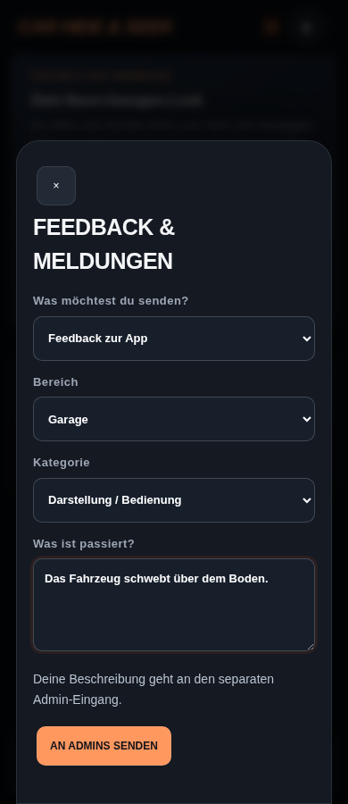
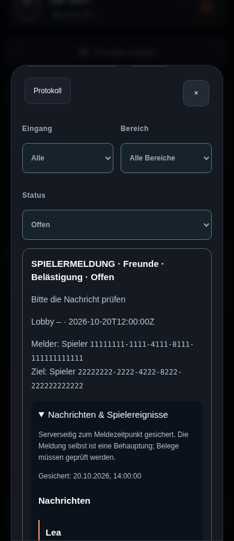
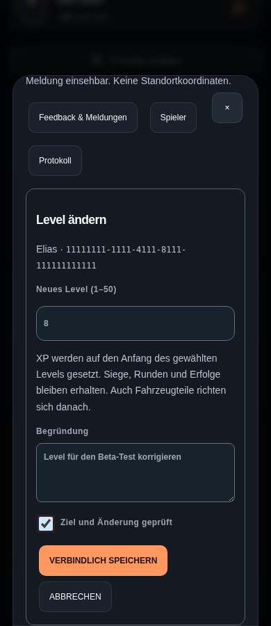
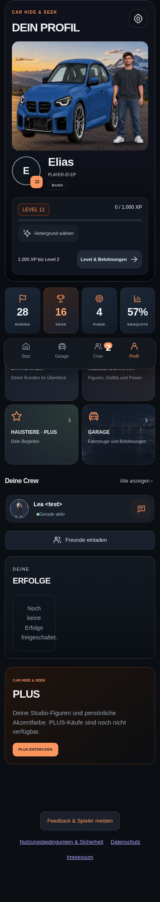

# Admin-Level, Feedback und Profilboden

Stand: 21. Oktober 2026. Implementiert und lokal geprüft; produktive Supabase-Einrichtung und Render-Deployment sind noch offen.

## Bedienung

- **Profil → Admin → Spieler → Mein Konto / Spieler suchen → Level ändern:** Admins und Superadmins können Level 1–50 mit Begründung setzen. Die XP werden auf `(Level − 1) × 1.000` gesetzt. Runden, Siege und bereits verdiente Erfolge bleiben erhalten. Freischaltungen und Ranglisten richten sich danach nach den neuen XP. Normale Admins können fremde Superadmins nicht ändern; das eigene Level lässt sich bearbeiten. Ein veralteter XP-Stand wird abgewiesen, damit zwischenzeitlich erspielter Fortschritt nicht versehentlich überschrieben wird.
- **Sperren / Entsperren:** Die bestehenden zeitweisen und dauerhaften Kontosperren bleiben unter Spieler erreichbar. Eine Meldung führt über „Spieler verwalten“ direkt zur passenden Person. Rollen- und Sperrschutz bleiben bestehen.
- **Seitenende → Feedback & Spieler melden:** Auswahl zwischen App-Feedback und Spielermeldung. Bereiche: Start, Lobby, Garage, Profil, Statistik, Freunde, Crew, Spielkarte, Kleiderschrank, Haustiere und Sonstiges. Der aktuelle Bereich ist vorausgewählt. Spieler lassen sich anhand von Name oder Tag suchen.
- **Freunde → Melden** oder **Chat → Nachricht melden:** Die gemeldete empfangene Nachricht wird anhand ihrer ID auf dem Server geladen. Melder, Absender und Nachricht müssen zusammenpassen.
- **Profil → Admin-Eingang:** Separater In-App-Zähler für offene Eingänge; Aktualisierung bei sichtbarer App alle 30 Sekunden. Im Eingang sind Art, Bereich und Bearbeitungsstatus filterbar. Zuständiges Personal kann Status und Begründung ändern. Dies ist keine Push-Mitteilung bei geschlossener App.

## Belege und Rechte

Lobby-/Spielkartenmeldungen eines tatsächlichen Teilnehmers können bis zu 30 letzte Lobby-Nachrichten und 50 Spielereignisse zum Meldezeitpunkt sichern. Der Server begrenzt diese Auszüge zusätzlich auf 32 KB. GPS, Tokens und interne Spielerfelder werden nicht übernommen. Bei einer Direktnachricht wird genau die vom Empfänger gemeldete Nachricht gesichert; die Adminoberfläche bietet keinen allgemeinen Zugang zu privaten Chats. App-Feedback aus anderen Bereichen hängt keine Lobby-Kommunikation an.

Die Belege stammen vom Server; vom Browser eingesendete Belege, Melder-IDs oder Bearbeitungsstatus werden nicht übernommen. Eine Meldung ist weiterhin eine zu prüfende Behauptung. Es werden keine automatischen Sanktionen verhängt. Moderatoren dürfen Eingänge prüfen, Admins zusätzlich Level ändern und sperren. Leveländerungen werden atomar zusammen mit Vorher-/Nachher-Werten im bestehenden unveränderlichen Adminprotokoll gespeichert.

Meldungen und angehängte Belege unterliegen der bestehenden Löschung: erledigte Meldungen nach 30 Tagen, alle spätestens nach 90 Tagen. Der bestehende Datenbank-Job bleibt zuständig. Neue Meldungen werden zusätzlich zu den HTTP-Limits dauerhaft auf zehn pro Konto und Stunde begrenzt. Die Datenschutzfassung wurde auf `2026-10-20.1` aktualisiert; der vorhandene Bestätigungsablauf zeigt sie erneut an.

## Profil

Der gewählte Hintergrund gehört jetzt direkt zum Fahrzeugbereich. Fahrzeug, Figur, Begleiter und Kontaktschatten haben einen gemeinsamen Bodenanker. Bildverhältnis und sichtbare Fotogrenzen bleiben erhalten. Die Szenenhöhe richtet sich nach dem größeren Element, damit auch frontale Fahrzeugfotos und Figuren vollständig sichtbar bleiben. Startseite und Garage behalten ihre vorherigen Größen.

## Bereitstellung

1. [Migration 20261020160000_feedback_admin_levels.sql](../supabase/migrations/20261020160000_feedback_admin_levels.sql) nach den vorhandenen Moderationsmigrationen anwenden. Die vorhandenen Profil-, Chat- und Moderationstabellen werden vorausgesetzt. Die Migration läuft in einer Transaktion und ist wiederholbar.
2. Bei Verwendung des Server-Gateways die Funktion `chs-server-gateway` aus diesem Repository erneut deployen. Die [Gateway-Freigaben](../supabase/functions/chs-server-gateway/gateway.mjs) erlauben die vier neuen RPCs und die neuen expliziten Lesespalten; der vorhandene Backend-Token bleibt bestehen. Mit der vorhandenen Supabase-CLI-Konfiguration: `supabase functions deploy chs-server-gateway --project-ref yyvljkzitodxhtkilsxm`. Ein direkter Supabase-Serverzugang benötigt nur die Migration.
3. App-Code übernehmen und Render deployen. Danach als normaler Spieler und als bestehender Admin anmelden und einen Testhinweis aus der Garage senden.

**Live-Blocker:** Die Supabase-Verwaltungs-API antwortete am 21. Oktober erneut mit HTTP 401. Migration und Gateway konnten deshalb nicht produktiv installiert werden. Es wurden keine echten Spielerkonten, Level oder Sperren verändert. Bei fehlender Einrichtung zeigt der neue Bereich eine Fehlermeldung; ein erfolgreicher Livebetrieb wurde nicht behauptet.

## Validierung

- 227 Node-Tests einschließlich HTTP-Zugangsschutz, Levelrollen, Eingabeprüfung, unvertrauenswürdiger Browser-Belege und begrenzter Lobby-Auszüge.
- 24 PostgreSQL/PGlite-Prüfungen der tatsächlichen Migration: eigene/fremde Level, Grenzen, veraltete XP, unveränderte Statistik, Audit, Rollen/Sperren, fremde Chats, einzelne Originalnachricht, Eingangszähler, Bearbeitung und dauerhafte Meldebegrenzung.
- 64 Browserprüfungen für Feedback, Spielerwahl, Nachrichtmeldung, Admin-Zähler, HTML-Escaping, eigenes Level, Sperrbedienelemente und Abmeldung auf 360/390/430/1024 Pixeln.
- 222 Showroom-Prüfungen für Auto-/Figurenmaß, Fotogrenzen, gemeinsame Bodenhöhe und vollständige Darstellung; zusätzlich alle sieben Figuren und elf Haustiere auf 390 Pixeln.
- 52 Regressionen der übrigen Spielansichten auf vier Breiten.

Browserprüfungen verwenden lokale Konten-/API-Fixtures und vorhandene Modellgrafiken als Testfotos, keine echten Spielerkonten. Der GitHub-Workflow führt die neue SQL-Prüfung zusätzlich aus.

```sh
npm test
node scripts/admin-feedback-sql-qa.mjs /tmp/chs-sql-qa/node_modules/@electric-sql/pglite/dist/index.js
CHS_QA_PLAYWRIGHT=/workspace/chs-qa/node_modules/playwright node scripts/admin-feedback-browser-qa.cjs
CHS_QA_PLAYWRIGHT=/workspace/chs-qa/node_modules/playwright node scripts/showroom-browser-qa.cjs
```

## Vorschaubilder








