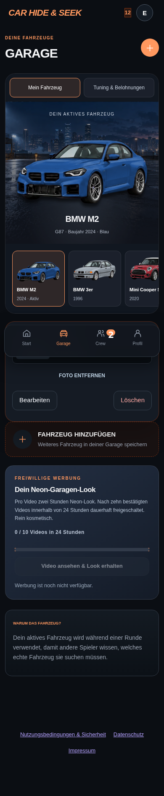
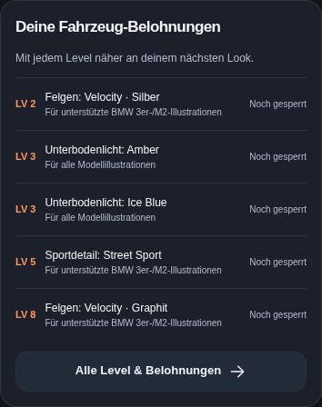
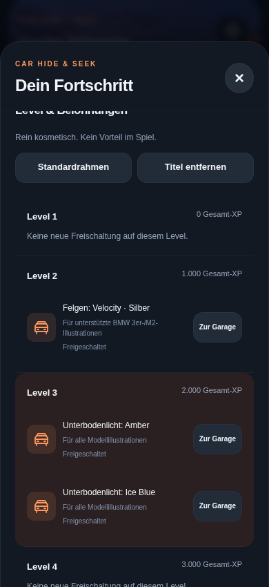

# Garage, Fahrzeuggröße und Fortschritt

Die Garage zeigt standardmäßig wieder das eigene Fahrzeugfoto, sofern eines gespeichert ist. Transparente Ränder werden nur für die Darstellung vermessen; die gespeicherte Datei bleibt erhalten. Ohne Foto erscheint die passende Modellillustration. Alle SVG-Vorschauen begrenzen die Darstellung auf das ausgewählte Auto, damit keine Nachbarfahrzeuge aus den Bildsammlungen erscheinen.

„Mein Fahrzeug“ enthält Auswahl, Fotowechsel, Bearbeiten, Löschen und Aktivieren. „Tuning & Belohnungen“ öffnet die Modellvorschau mit den vorhandenen Felgen, Sportdetails und Unterbodenlichtern. Eigene Fotos werden durch diese Vorschau nicht ersetzt. Auf der Startseite sind Auto und zugehörige Figur um zehn Prozent kleiner; der Bodenanker bleibt gleich. Die Profilskalierung ist unverändert.

## Sichtbare Levelbelohnungen

Statistik und Fortschrittsübersicht verwenden denselben Fahrzeugkatalog wie die Garage:

| Level | Freischaltung |
| --- | --- |
| 2 | Velocity-Felgen in Silber |
| 3 | Unterbodenlicht Ice Blue und Amber |
| 5 | Street-Sport-Seitenschweller |
| 8 | Velocity-Felgen in Graphit |

Felgen und Sportdetail sind weiterhin auf die bereits kalibrierten BMW-3er-/M2-Illustrationen beschränkt. Die UI benennt diese Einschränkung. Bestehende Rahmen und Titel bleiben in der Levelübersicht enthalten; bei mehreren Belohnungen auf dem nächsten Freischaltungslevel werden alle angezeigt. Erreichte Fahrzeugbelohnungen führen direkt zur Garage.

## Neun zusätzliche Erfolge

| Erfolg | Voraussetzung | Bonus-XP |
| --- | --- | --- |
| Warmgefahren | 5 Runden | 100 |
| Stammfahrer | 25 Runden | 250 |
| Straßenlegende | 100 Runden | 500 |
| Auf der Überholspur | 5 Siege | 150 |
| Podiumsjäger | 25 Siege | 350 |
| Spürnase | 10 bestätigte Funde | 150 |
| Radarprofi | 50 bestätigte Funde | 350 |
| Schattenfahrer | 5 überlebte Versteckerrunden | 150 |
| Unsichtbar | 25 überlebte Versteckerrunden | 350 |

Die drei bisherigen Erfolge bleiben erhalten. Karten und Detailansicht zeigen tatsächliche Zähler und Zielwerte. Vergabe und XP-Bonus erfolgen ausschließlich in der vorhandenen RPC für serverbestätigte Rundenergebnisse. Wiederholte Claims vergeben keinen weiteren Bonus. Bestehende Spieler nehmen ihre bisherigen Zähler mit; bereits erfüllte neue Erfolge erhalten sie nach der nächsten abgeschlossenen, erstmals beanspruchten Runde.

## Bereitstellung

1. [Migration 20261020130000_more_achievements.sql](../supabase/migrations/20261020130000_more_achievements.sql) auf dem vorhandenen Supabase-Projekt anwenden. Die bisherigen Ergebnis-/Profil-/Erfolgstabellen und die Funktion `chs_private.account_allowed()` müssen vorhanden sein. Die neue Migration ist wiederholbar und läuft in einer Transaktion.
2. App-Änderungen über GitHub übernehmen und auf Render deployen. Die Cache-Versionen der geänderten Browserdateien wurden angehoben.

**Produktive Migration noch offen:** Der hier konfigurierte Supabase-Verwaltungszugang antwortete bei der Projektabfrage mit HTTP 401. Es wurde deshalb keine produktive Datenbank geändert. Die Migration wurde lokal mit PostgreSQL-Semantik geprüft. Sie lässt sich nach Prüfung im [SQL-Editor des Projekts](https://supabase.com/dashboard/project/yyvljkzitodxhtkilsxm/sql/new) ausführen. Ohne Migration funktionieren die Ansichten und bisherigen Erfolge weiter; die neun neuen Katalogeinträge erscheinen erst nach Anwendung der SQL-Datei.

## Prüfung

- 219 Node-Tests.
- 76 SQL-Prüfungen der tatsächlichen Migration: alle neun Schwellen davor/danach, bisherige Erfolge, Veteranen, XP/Level, wiederholte Migrationen und Claims, gefälschte Ergebnisse, andere Konten, Sperren und verbotene Direktzugriffe.
- 100 Browserprüfungen für Garage, eigene Fotos, Fahrzeugwechsel, Tuning, Freischaltungen, Levelnavigation, Erfolgszähler und leere Garage auf 360/390/430/1024 Pixeln.
- 172 bestehende Showroom-Prüfungen für Front-/Seitenansichten, transparente Ränder, normale Fotos, Bodenkontakt, Überlappungen und Profil.
- 52 Prüfungen der übrigen überarbeiteten Spielansichten auf vier Bildschirmbreiten.

Browserbilder verwenden lokale Testkonten und ein aus vorhandener Modellgrafik erzeugtes Testfoto. Sie prüfen keine echten Spielerfotos, Supabase-Sitzungen oder Render-Deployments.

```sh
npm test
node scripts/achievements-sql-qa.mjs /tmp/chs-sql-qa/node_modules/@electric-sql/pglite/dist/index.js
CHS_QA_PLAYWRIGHT=/workspace/chs-qa/node_modules/playwright node scripts/garage-progress-browser-qa.cjs
CHS_QA_PLAYWRIGHT=/workspace/chs-qa/node_modules/playwright node scripts/showroom-browser-qa.cjs
CHS_QA_PLAYWRIGHT=/workspace/chs-qa/node_modules/playwright node scripts/game-design-browser-qa.cjs
```

Der SQL-Testläufer wird im GitHub-Workflow isoliert installiert. Die Browserbefehle setzen Chromium und Playwright an den angegebenen lokalen Pfaden voraus.

## Vorschau






