# Designvorschläge für die Handyansicht

Zwölf einzelne Gestaltungsvorschläge für CAR HIDE & SEEK. Die Live-App wurde dafür nicht verändert. Personen, Zahlen und Kartendetails sind Beispiele.

**Bedienung:** Nach unten scrollen. Ein Klick auf ein Bild öffnet die Einzelansicht. Unter jedem Bild steht der passende Umsetzungsprompt.

[Alle vollständigen Umsetzungsprompts und gemeinsamen Vorgaben](UMSETZUNGSPROMPTS.md)

## Bereiche

- [01 – Start](#01)

- [02 – Profil](#02)

- [03 – Statistiken](#03)

- [04 – Profileinstellungen](#04)

- [05 – Lobby / Warteraum](#05)

- [06 – Lobby-Einstellungen](#06)

- [07 – Garage](#07)

- [08 – Kleiderschrank / Figuren](#08)

- [09 – Haustiere](#09)

- [10 – Freunde und Crew](#10)

- [11 – Laufende Runde / Spielkarte](#11)

- [12 – Rundenergebnis](#12)

## 01 – Start

[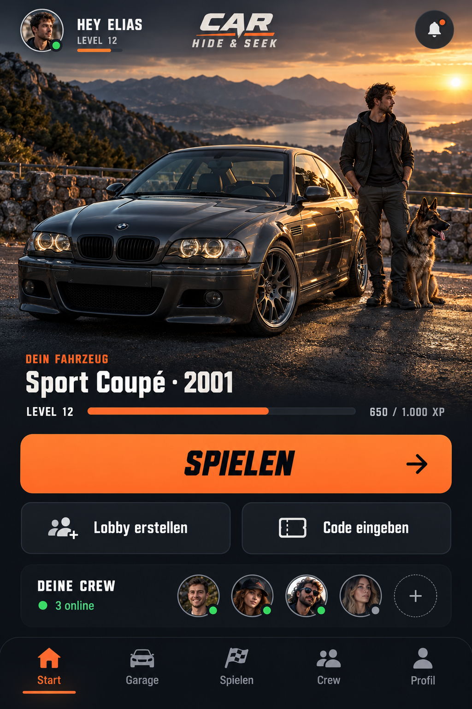](01.png)

**Umsetzungsprompt:**

Überarbeite `#home` und die tatsächlich verwendeten Showroom-Komponenten anhand von Bild 01. Das aktive Fahrzeug soll der Blickfang sein: etwa 80 Prozent der Szenenbreite, ohne abgeschnittene Räder oder Stoßfänger. Passe Kamera und Objektposition für Hochformat an, statt nur das fertige Bild größer zu skalieren. Sorge für glaubwürdige Bodenkontakte, Kontaktschatten und eine Perspektive, die zum ausgewählten Hintergrund passt. Figur und optionales Haustier stehen maßstabsgerecht neben dem Fahrzeug und verdecken es nicht. Prüfe besonders kurze Kleinwagen, lange Limousinen und hohe SUVs.

Platziere oben einen korrekt rund zugeschnittenen Profilavatar mit Namen und Benachrichtigungen. Unter der Szene stehen aktives Fahrzeug, echter Level und XP-Balken. Eine große Aktion „Spielen“ führt in die vorhandene Spielsuche; „Lobby erstellen“ und „Code eingeben“ bleiben als sekundäre Aktionen erreichbar. Darunter erscheint eine kompakte Crew-Zeile mit tatsächlichem Anwesenheitsstatus. Die Navigation darf keine Aktionen überdecken. Die Szene bleibt auch auf kleinen Handys groß, ohne wichtige Spielaktionen unter mehrere Bildschirmhöhen zu schieben.

[Vollständigen Einzelprompt öffnen](01-prompt.txt)

## 02 – Profil

[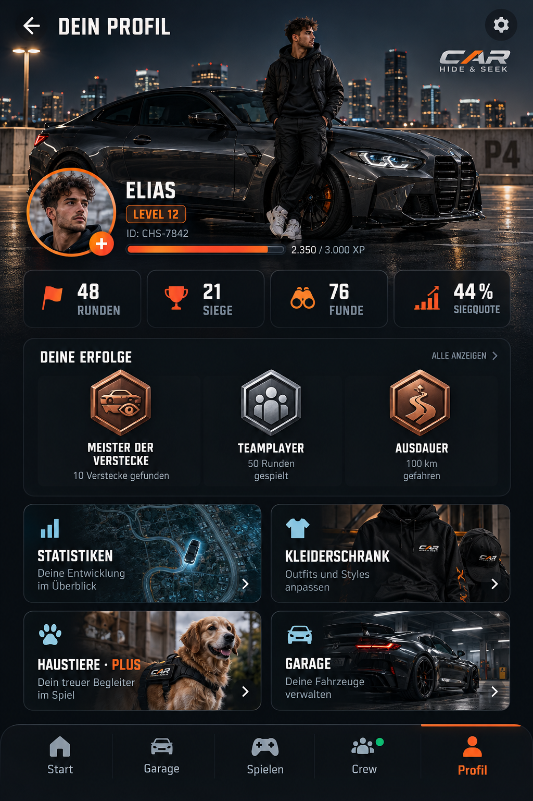](02.png)

**Umsetzungsprompt:**

Überarbeite `#profile`, `.profileHero`, `#profileVehicleStage` und die Profilnavigation nach Bild 02. Gestalte das Profil als persönliche Spielerkarte mit korrekt rund zugeschnittenem Avatar, Spielername, Spieler-ID und tatsächlicher Mitgliedschaft. Stelle Fahrzeug, Figur und optionalen Begleiter in einer zusammenhängenden Szene dar. Level und XP bleiben echte Kontowerte.

Zeige Runden, Siege, Funde und Siegquote in vier gut lesbaren, kompakten Wertefeldern. Erfolge werden als hochwertige Abzeichen mit Titel und tatsächlichem Freischaltstatus präsentiert; gesperrte Abzeichen erhalten einen klaren Hinweis. Ersetze die lange ungegliederte Menüliste durch übersichtliche Zugänge zu Statistiken, Kleiderschrank, Haustieren und Garage. Konto und Einstellungen sind über das Zahnrad erreichbar. Alle bisherigen Profilaktionen müssen weiterhin funktionieren. PLUS wird nur angezeigt, wenn die vorhandene Berechtigungsquelle das bestätigt.

[Vollständigen Einzelprompt öffnen](02-prompt.txt)

## 03 – Statistiken

[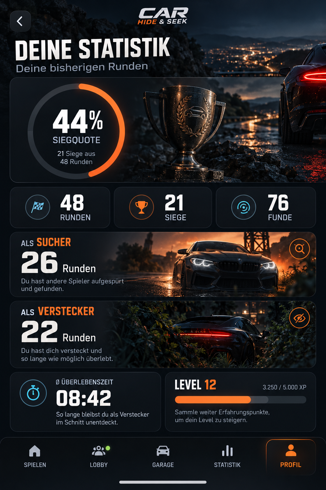](03.png)

**Umsetzungsprompt:**

Gestalte `openProfileStatistics()` und `#profileStatsDialog` aus `app.js` nach Bild 03 als mobile Vollbildansicht beziehungsweise auf größeren Displays als passenden Dialog. Ersetze die einfachen Textzeilen durch einen großen Siegquotenring, drei prägnante Kennzahlen und zwei Rollenbereiche für Sucher und Verstecker. Verwende für Runden, Siege, Funde, überlebte Runden, Level und XP die bestehenden Profilwerte und für die Rollenstatistik den vorhandenen `personal-stats`-Aufruf. Die durchschnittliche Überlebenszeit erhält eine verständlich beschriftete Darstellung.

Berechne die Siegquote aus den echten Werten, verhindere Division durch null und zeige bei fehlenden Werten keine erfundenen Zahlen. Ohne gespielte Runden erscheint ein hilfreicher Einstieg. Bei API-Fehlern bleiben die verfügbaren Profilwerte sichtbar und die Rollenstatistik meldet ihren Ladefehler. Zeige keine Verlaufsdiagramme, Ranglisten, Saisondaten oder Zeitfilter, wenn dafür keine echte Datenquelle existiert. Stelle sicher, dass spätere Antworten nicht das Profil eines inzwischen gewechselten Kontos überschreiben.

[Vollständigen Einzelprompt öffnen](03-prompt.txt)

## 04 – Profileinstellungen

[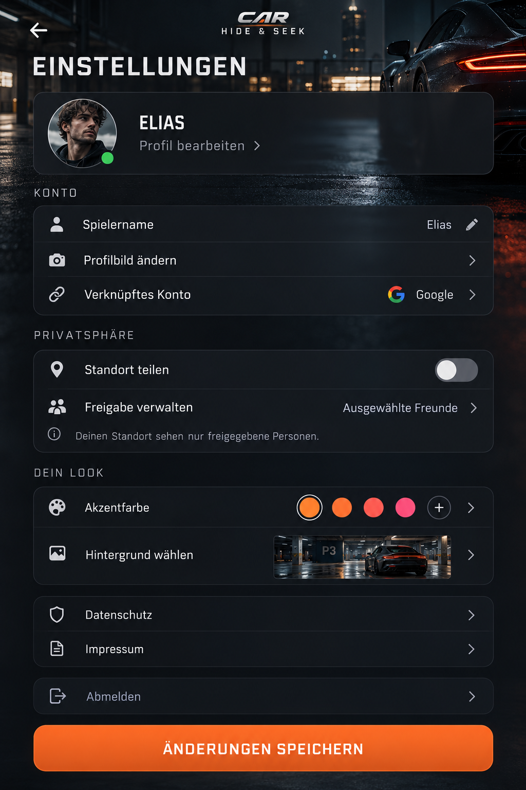](04.png)

**Umsetzungsprompt:**

Überarbeite den bestehenden Profileditor und die zugehörigen Einstellungsoberflächen nach Bild 04. Ordne die Einstellungen in Konto, Privatsphäre und persönlicher Look. Zeige Profilbild, Spielername und verknüpftes Konto in einer kompakten Identitätskarte. Die Bildänderung verwendet den vorhandenen Upload und eine korrekt runde Vorschau. Kontoangaben werden nur dort bearbeitbar, wo die bestehende Kontoverknüpfung das unterstützt.

Führe zur vorhandenen Standortfreigabe mit den echten Optionen für aus, erlaubte Personen und gegebenenfalls alle freigegebenen Freunde. Erkläre verständlich, wer den Standort sehen darf. Übernimm bestehende Freigaben; ändere sie nicht durch das bloße Öffnen der Seite. Akzentfarbe ist PLUS-geschützt und wird mit zugänglichen Farbfeldern statt einem unbeschrifteten Farbstreifen dargestellt. Hintergrundwahl bleibt erreichbar. Datenschutz, Nutzungsbedingungen, Impressum und Abmelden sind klar auffindbar. Eine feste Speichern-Aktion darf nur Einstellungen speichern, die tatsächlich gemeinsam gespeichert werden können; kennzeichne getrennt gespeicherte Freigaben korrekt. Während des Speicherns Doppelklicks verhindern und Fehler bei den betroffenen Feldern anzeigen.

[Vollständigen Einzelprompt öffnen](04-prompt.txt)

## 05 – Lobby / Warteraum

[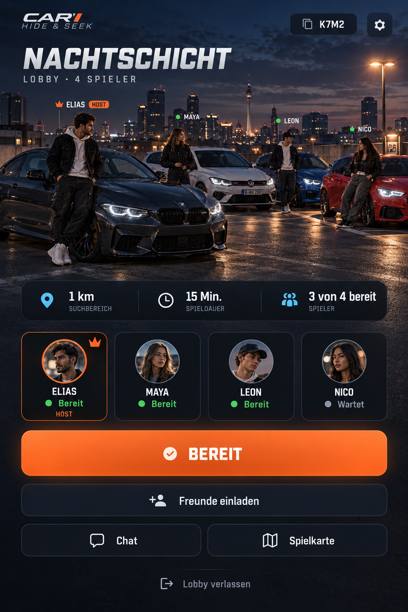](05.png)

**Umsetzungsprompt:**

Überarbeite den Warteraum in `#game`, die Crew-Darstellung und `lobby-scene.js` nach Bild 05. Zeige die Crew als zusammenhängende Parkszene mit korrekt skalierten Fahrzeugen und Figuren. Das eigene Fahrzeug ist gut erkennbar; bei vielen Spielern wird eine horizontale Auswahl oder fokussierte Szene verwendet, statt alle Objekte unlesbar klein zu machen. Fehlende Assets erhalten einen ruhigen Ersatz.

Oben stehen Lobbyname, kopierbarer Code und der Zugang zu den Host-Einstellungen. Darunter folgen kompakte, echte Angaben zu Spielgebiet, Zeit und Anzahl bereiter Spieler. Markiere Host, eigene Person und Bereitschaft eindeutig. Die Hauptaktion heißt für Teilnehmer „Bereit“ beziehungsweise „Nicht mehr bereit“ und für den Host „Runde starten“, soweit die bestehenden Startbedingungen erfüllt sind. Freunde einladen, Chat, Spielkarte und Verlassen bleiben erreichbar. Standort und Rolleninformationen werden nur nach den bestehenden Spielregeln gezeigt. Erfinde weder Teilnehmer noch Onlinezustände. Berücksichtige Vollbelegung, Verbindungsabbruch und einen Hostwechsel.

[Vollständigen Einzelprompt öffnen](05-prompt.txt)

## 06 – Lobby-Einstellungen

[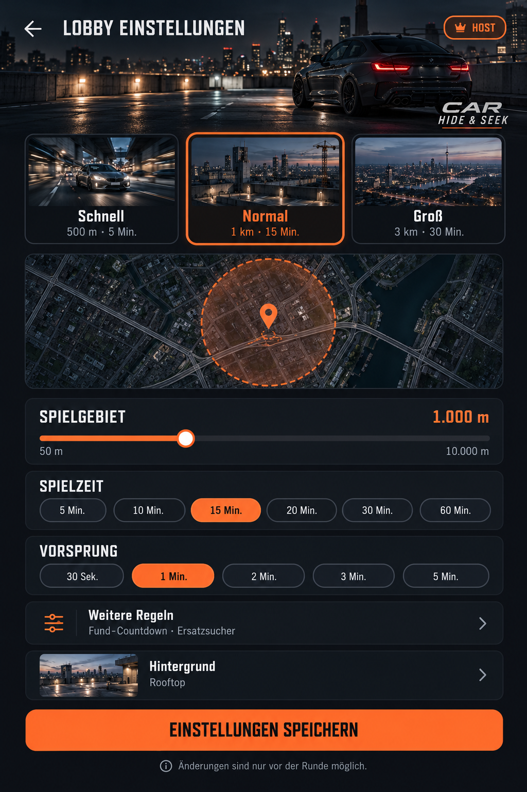](06.png)

**Umsetzungsprompt:**

Gestalte `#freshSettingsDialog` und `#lobbySettingsPanel` nach Bild 06 als eigenständige, gut bedienbare Handyansicht. Ersetze die optisch alten Select-Listen dort durch zugängliche Auswahlkarten, Segmentknöpfe und beschriftete Schieberegler, wo die vorhandenen Werte das zulassen. Biete die bestehenden Vorlagen Schnell (500 m / 5 Min.), Normal (1 km / 15 Min.), Groß (3 km / 30 Min.) und Individuell an. Markiere die aktive Vorlage; bei einer abweichenden Einzeländerung wird Individuell aktiv.

Erhalte den gesamten Bereich für den Radius von 50 bis 10.000 m und zusätzlich ein präzises numerisches Eingabefeld. Spielzeit bietet die vorhandenen Werte 5, 10, 15, 20, 30 und 60 Minuten. Vorsprung bietet 30 Sekunden, 1, 2, 3 und 5 Minuten; Fund-Countdown 10 oder 15 Sekunden. Erhalte die Ersatzsucher-Regel und die Hintergrundauswahl. Zeige im kompakten Hauptbereich die häufigen Optionen; seltene Optionen dürfen unter „Weitere Regeln“ liegen, müssen aber vollständig erreichbar sein. Nur der Host kann vor der Runde bearbeiten. Andere Spieler sehen die Regeln mit einer eindeutigen Lesebeschränkung. Speichern verwendet die bestehenden API-Aufrufe und erhält Bereitschaften entsprechend der bisherigen Logik. Die kleine Kartenvorschau ist nur ein gestalterischer Überblick und darf keine versteckten Spieler verraten.

[Vollständigen Einzelprompt öffnen](06-prompt.txt)

## 07 – Garage

[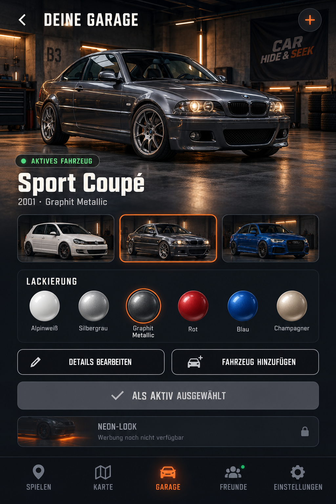](07.png)

**Umsetzungsprompt:**

Überarbeite `#garage`, `#garageCars`, die Fahrzeugsuche und die Showroom-Steuerung nach Bild 07. Das gewählte Fahrzeug steht groß in einer glaubwürdigen Garagenszene mit korrekter Bodenebene. Eine kompakte Fahrzeugauswahl mit Vorschaubildern macht weitere eigene Fahrzeuge erreichbar. „Als aktiv wählen“ zeigt den echten Aktivstatus und nutzt die vorhandene Speicherung. Details bearbeiten und Fahrzeug hinzufügen bleiben eigene erkennbare Aktionen.

Modell, Generation und Baujahr müssen zur tatsächlichen Auswahl passen. Erhalte die vorhandene marken- und generationenabhängige Fahrzeugsuche und die Jahresauswahl. Eine realistische Lackvorschau darf Glas, Reifen, Leuchten und Metallteile nicht pauschal mit einfärben. Verwende die vorhandenen Lackmasken und Materialien. Fahrzeugfarben sind kein automatisch neuer PLUS-Vorteil; erhalte die bestehenden Rechte. Die freiwillige Neon-Werbekarte bleibt erreichbar, erscheint aber kompakt und zeigt bis zu einer echten Anbieterfreigabe „Werbung noch nicht verfügbar“. Keine simulierten Videos oder Belohnungen und keine neuen Käufe ergänzen.

[Vollständigen Einzelprompt öffnen](07-prompt.txt)

## 08 – Kleiderschrank / Figuren

[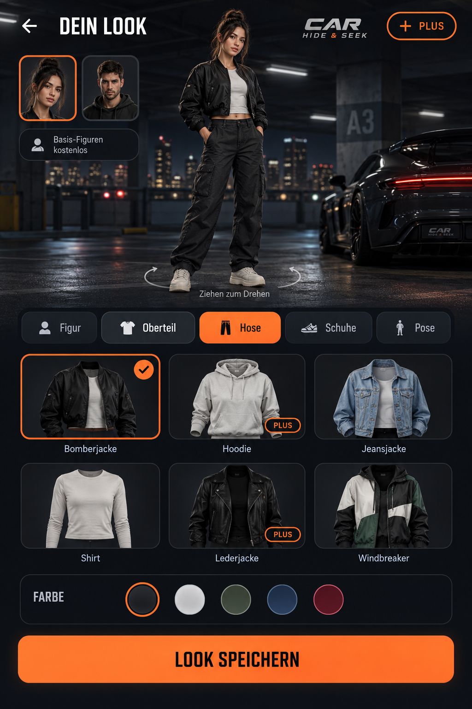](08.png)

**Umsetzungsprompt:**

Gestalte den bestehenden Kleiderschrank in `wardrobe.js`, `character-studio.js` und den zugehörigen UI-Komponenten nach Bild 08. Eine große ganze Figur steht auf einer gemeinsamen Bodenebene und lässt sich in den vorhandenen Ansichten beziehungsweise Posen prüfen. Füge verständliche Reiter für Figur, Oberteil, Hose, Schuhe und Pose hinzu und zeige nur Kategorien, die tatsächlich unterstützt sind. Darunter stehen übersichtliche Vorschaubilder mit Namen und klar markierter Auswahl. Verwende realistische, zum Autospiel passende Streetwear statt einer Comic- oder Selfie-Collage.

Alle bestehenden kostenlosen Lobbyfiguren bleiben für kostenlose Konten auswählbar. Vorhandene PLUS-Figuren, Kleidungsstücke und Posen werden entsprechend den tatsächlichen Rechten markiert und serverseitig geschützt. Die vormals wiederhergestellten Figuren dürfen nicht erneut verschwinden. Ein Tipp auf eine gesperrte Auswahl erklärt PLUS, startet aber keinen Kauf. Zeige die verfügbaren Varianten für männliche und weibliche Figuren fair und übersichtlich. Aussehen und Pose werden aus den bestehenden Auswahlwerten gespeichert. Die pausierte Foto-zu-Figur-Funktion erhält keinen aktiven Kamera- oder Uploadknopf und wird nicht als fertig dargestellt.

[Vollständigen Einzelprompt öffnen](08-prompt.txt)

## 09 – Haustiere

[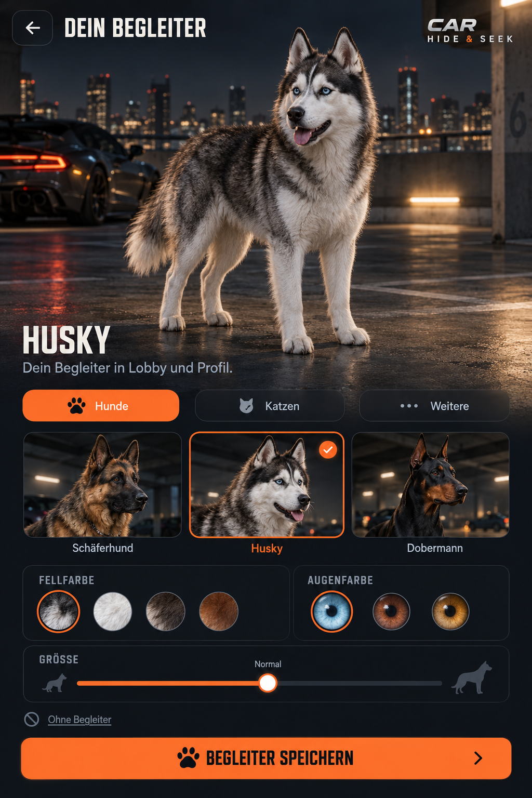](09.png)

**Umsetzungsprompt:**

Überarbeite den separaten Haustierbereich in `pet-ui.js`, `pets.js` und `pets.css` anhand von Bild 09. Er bleibt ein eigenes Ziel im Profil und wird nicht in den Kleiderschrank verschoben. Oben steht eine große realistische Vorschau des gewählten Begleiters mit korrektem Bodenkontakt; darunter eine übersichtliche Arten- und Rassenauswahl. Alle vorhandenen elf Varianten müssen erreichbar bleiben, einschließlich Schäferhund, Husky, Dobermann, Bengal-Katze, British Shorthair, Papagei, Fisch im runden Aquarium, Hamster, Pferd, Affe und Esel.

Fell- beziehungsweise Gefiederfarbe, Augenfarbe, Größe und unterstützte Ausrichtung oder Pose werden passend zur jeweiligen Tierart angeboten. Zeige bei einem Fisch beispielsweise keine irreführende Felloption. Verfügbare Sitz-/Stehvarianten der British Shorthair bleiben erhalten. Farben erhalten verständliche Namen und markierte Auswahlzustände. Pferd und Kleintiere benötigen artspezifische Größen- und Platzierungsregeln in den gemeinsamen Szenen. Begleiter sind PLUS-geschützt; die serverseitige Prüfung bleibt verbindlich. „Ohne Begleiter“ bleibt möglich. Speichere weiterhin unabhängig im bestehenden `chs_pet`-Metadatenfeld. Zeige einen ehrlichen Nur-Vorschau-Zustand ohne PLUS und keinen funktionierenden Kaufknopf.

[Vollständigen Einzelprompt öffnen](09-prompt.txt)

## 10 – Freunde und Crew

[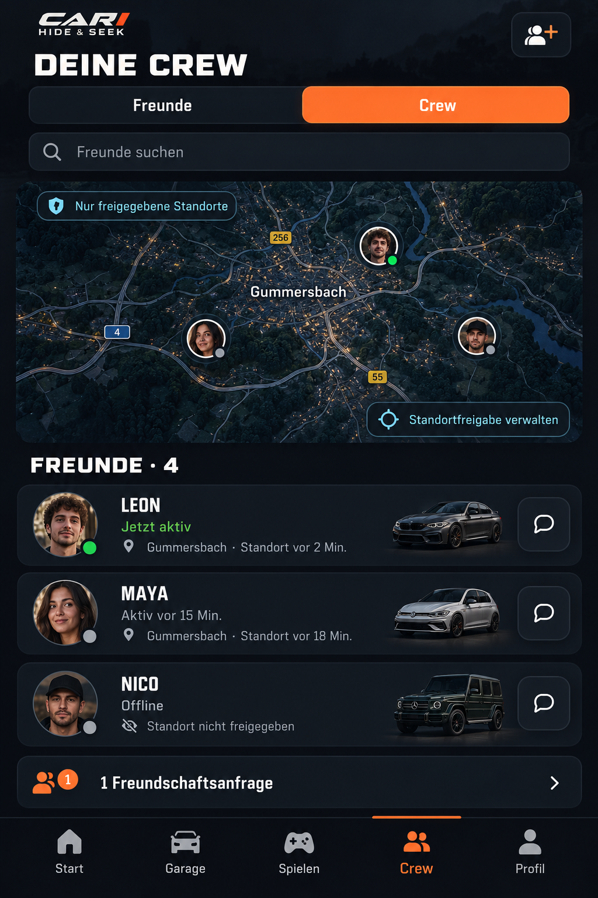](10.png)

**Umsetzungsprompt:**

Überarbeite `#friends` sowie die bestehenden Crew- und Standortkomponenten anhand von Bild 10. Nutze die Reiter Freunde und Crew, eine gut lesbare Suche und einen kompakten Zugang zu Einladungen beziehungsweise Anfragen. Freundeskarten zeigen Avatar, Namen, echten Anwesenheitsstatus und – nur bei vorhandener Freigabe – die letzte bekannte Ortsangabe und den Zeitpunkt. Unterscheide „Jetzt aktiv“, „Aktiv vor …“ und „Standort aktualisiert vor …“; Aktivität bedeutet nicht automatisch einen frischen Standort.

Die soziale Karte zeigt ausschließlich berechtigt freigegebene Personen und keinen Spielradius. Zugriff und Filterung müssen weiterhin serverseitig durchgesetzt sein. Biete gut sichtbar „Standortfreigabe“ und die bestehende Auswahl einzelner Personen an. Ohne Freigabe stehen weder Koordinaten noch Ortsnamen im DOM, in Vorschauen oder in Kartenmarkern. Erhalte Freundschaftsanfragen, Entfernen, Crew-Verwaltung und Nachrichten. Die Karte benötigt klare Zustände für fehlende Einrichtung, keine Freigaben, verweigerte GPS-Berechtigung und veraltete Positionsdaten. Zeige keine fiktive Entfernung oder Aktivitätszeit.

[Vollständigen Einzelprompt öffnen](10-prompt.txt)

## 11 – Laufende Runde / Spielkarte

[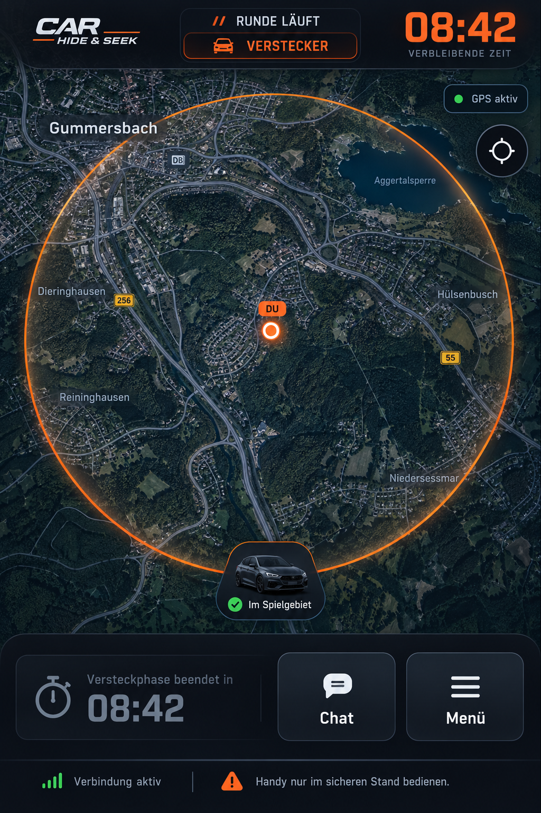](11.png)

**Umsetzungsprompt:**

Gestalte die aktive Runde und die vorhandene Spielkarte nach Bild 11 als konzentrierte Spieloberfläche. Die Karte nimmt den größten Bereich ein; oben stehen ein echter Runden-Timer und die eigene Rolle. Nutze darunter nur die Informationen und Aktionen, die für die aktuelle Rolle und Phase erlaubt sind. Halte Markierungen, Lesbarkeit und Zoom auf kleinen Bildschirmen brauchbar. Die Radiusgrenze muss sich aus dem echten Spielgebiet ergeben. Kartenmittelpunkt und Follow-Funktion bleiben vorhanden.

Ändere die bestehenden Regeln zur Sichtbarkeit von Suchern und Versteckern nicht. Zeige insbesondere keine Gegnerposition nur für einen attraktiveren Entwurf. Die vereinfachte Karte im Bild ist eine Gestaltungsreferenz; produktiv werden echte Kartendaten und die vorhandenen Datenschutzregeln verwendet. Erhalte Fund-Countdown, Vorsprung und Verbindungszustände. Chat und Menü sind kompakt erreichbar, aber stören die Karte nicht. Die normale Seitennavigation tritt während der Runde zurück. Zeige keine Werbung während der Runde. Ergänze einen gut lesbaren Hinweis, das Handy nur im sicheren Stand zu bedienen; fordere nicht zur Bedienung während der Fahrt auf.

[Vollständigen Einzelprompt öffnen](11-prompt.txt)

## 12 – Rundenergebnis

[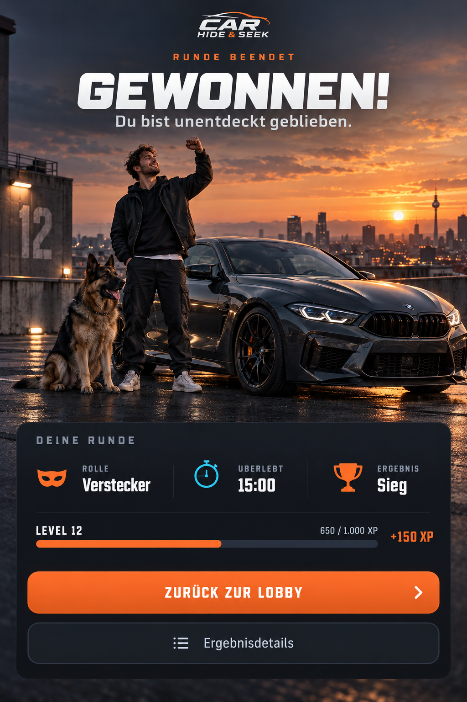](12.png)

**Umsetzungsprompt:**

Überarbeite `#result` und die bestehende Ergebnispräsentation nach Bild 12. Verwende eine große eindeutige Ergebnisüberschrift, die je nach tatsächlichem Ausgang Sieg, Niederlage, Abbruch oder reguläres Rundenende korrekt darstellt. Zeige die eigene Figur mit unterstützter Pose, Fahrzeug und optionalem Begleiter glaubwürdig auf derselben Bodenebene. Gewinnerposen dürfen nur entsprechend den bestehenden PLUS-Rechten ausgewählt werden; eine normale Siegesanzeige bleibt für alle verfügbar.

Ergebniswerte, Funde und XP stammen aus dem gespeicherten Rundenergebnis. Verwende keine erfundene Platzierung, Bestenliste oder Belohnung. Erfolge und Fortschritte erscheinen nur bei tatsächlich bestätigter Vergabe. Die Hauptaktion führt zurück in die Lobby; Ergebnisdetails sind sekundär erreichbar. Ein optionales belohntes Video wird nur gezeigt, wenn die tatsächliche Anbieterintegration, Einwilligung und Freischaltung es erlauben. Bis dahin bleibt der Bereich verborgen oder ehrlich als nicht verfügbar beschriftet. Bestehende Werbung nach der Runde respektiert die geltenden Begrenzungen und Mitgliedschaftsrechte; ein Werbevideo startet hier nicht allein durch die Neugestaltung.

[Vollständigen Einzelprompt öffnen](12-prompt.txt)

## Hinweise zur Umsetzung

Die gemeinsame Navigation und die bestehenden Funktionen sind in den Prompts verbindlich beschrieben. Einzelne Bildbeschriftungen sind illustrative Beispiele. Konfigurierbare Figuren und Fahrzeuge benötigen passende nutzbare Assets; die generierten Ansichten sind Gestaltungsvorlagen.
