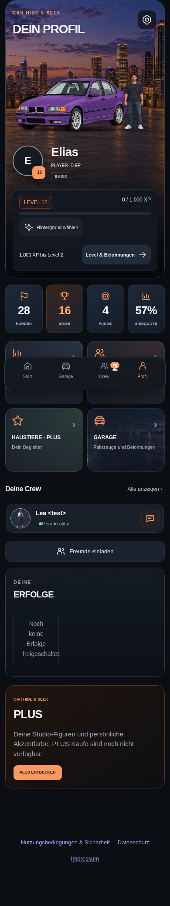
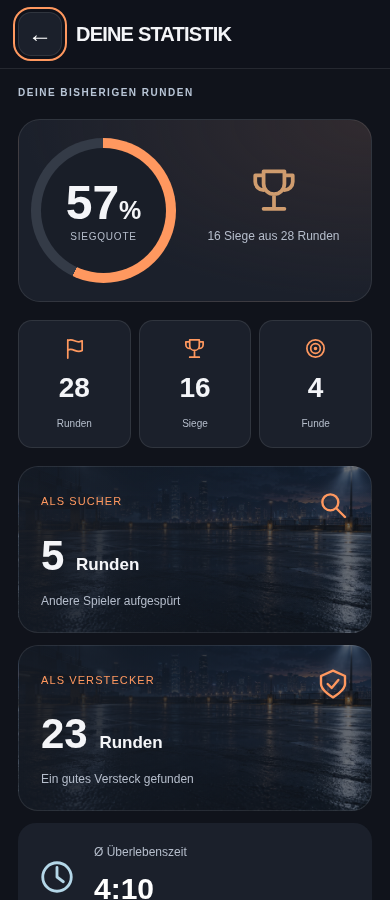
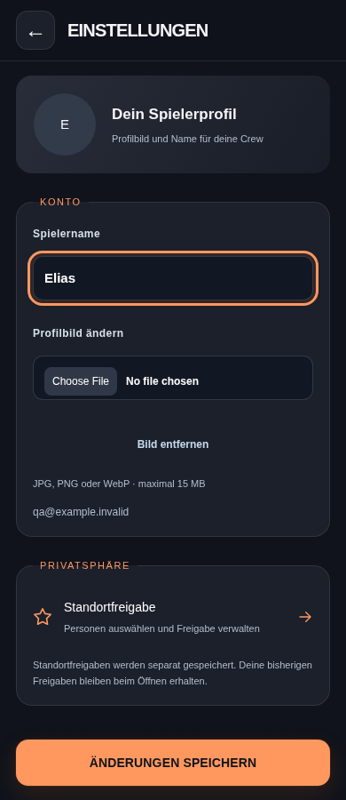
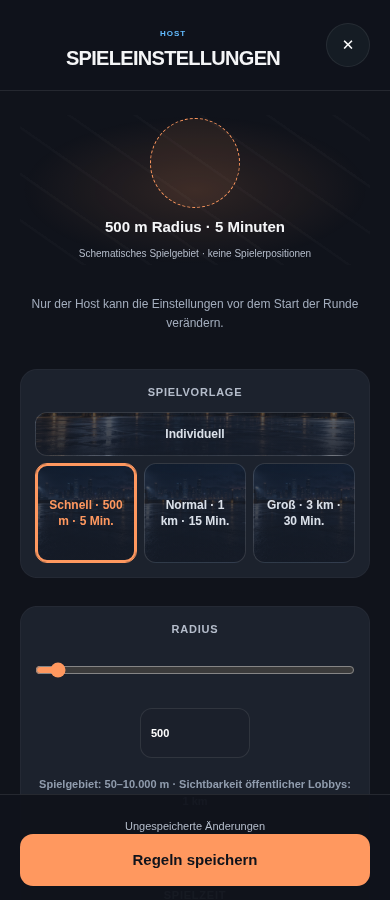
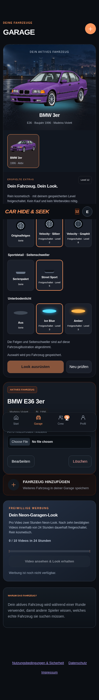
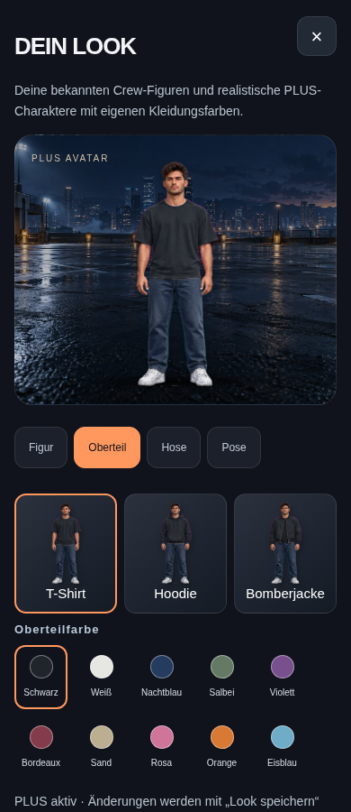
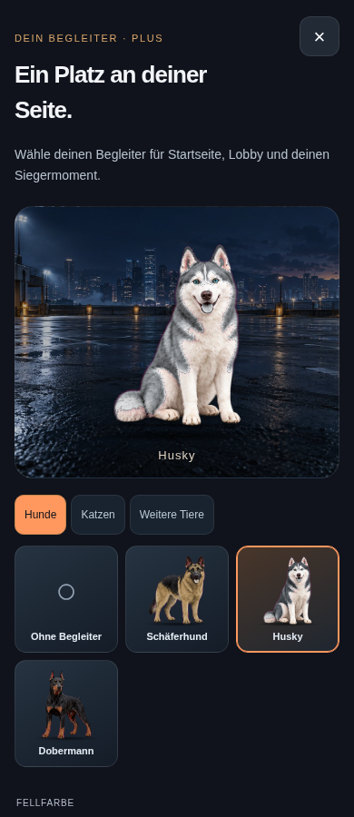
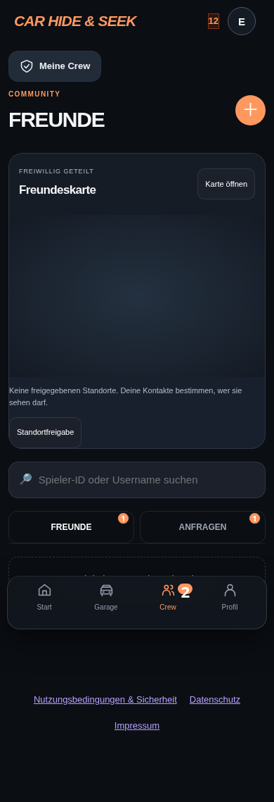
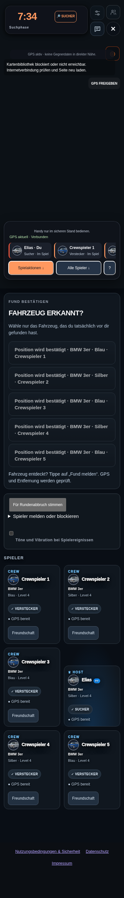
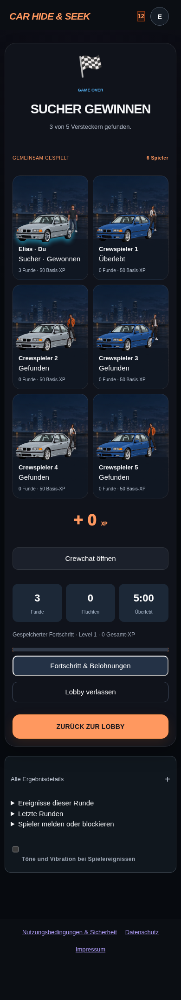

# Umgesetzte mobile Ansichten

Screenshots der tatsächlichen App mit lokalen Testkonten bei 390 px. Namen und Werte sind Testdaten. Die Spielkarte zeigt hier bewusst den Fehlerzustand ohne externe Kartenkacheln; die freigegebene soziale Karte wurde zusätzlich mit MapLibre getestet. Dies ist kein Nachweis eines produktiven Deploys.

[Umfang, Voraussetzungen und Tests](../mobile-game-redesign.md)

## Profil

## Statistiken

## Profileinstellungen

## Lobby-Regeln

## Garage

## Kleiderschrank

## Haustiere

## Freunde

## Laufende Runde

## Rundenergebnis

